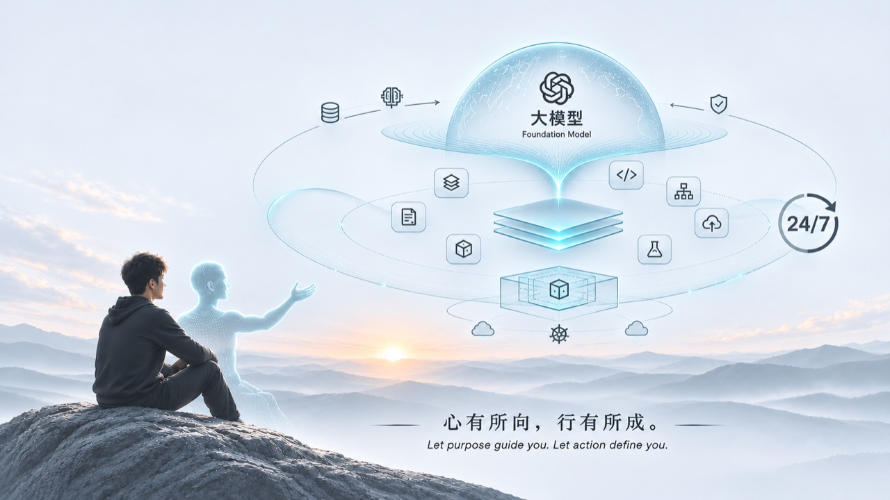

<a href="README.md">简体中文</a> · <strong>English</strong>

### Hi, I'm Changfeng

I'm Shangzhi Li, also known as **长风 (Changfeng)**, based in Shenzhen. I explore LLMs, agents, and software engineering through hands-on projects.

I want to turn model calls into **systems that can keep doing useful work and produce verifiable results**. I learn, build, validate, and share the results as open-source tools.

 

### Areas of interest

- **Agent engineering** — Execution, sessions, task management, and result validation, with a process that people can follow.
- **AI-assisted development** — AI across requirements, coding, testing, and review; turning hands-on experience into reusable tools and methods.
- **Runtime infrastructure** — Runtimes, sandbox isolation, and state recovery, with a focus on the reliability of long-running work.

### Open Agent Systems

Building composable AI development tools and foundations.

[GitHub organization](https://github.com/Open-Agent-Systems) · [Website](https://open-agent-systems.github.io/)
