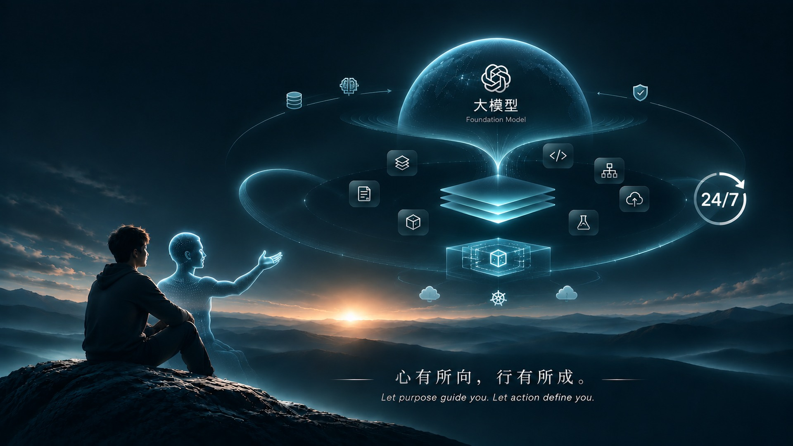

  

  <strong>简体中文</strong> · <a href="README.en.md">English</a>

## 你好，我是长风

李尚志，深圳，GitHub 上的 **iShangZhi**。一个追逐 AI 前沿，也愿意把想法写成代码的人。

我关注大模型与智能体如何改变软件开发，也在探索：**从一次模型调用，到能够持续完成工作的智能系统，需要补齐哪些工程能力？**

学习新技术、动手验证、沉淀工具，是我参与这场变化的方式。我希望人与 AI 的协作，能逐步走向可靠、可理解、可持续的工程实践。

## 正在探索

- **智能体工程** — 关注 Agent 的执行、会话、任务管理与结果验证，让复杂工作有可追踪的过程。
- **AI 辅助研发** — 探索 AI 如何参与需求理解、编码、测试与评审，把实践沉淀为可复用的工具和方法。
- **运行基础设施** — 研究运行时、沙箱隔离与状态恢复，理解长任务背后的可靠性边界。

## Open Agent Systems

正在建设，探索可组合的 AI 开发工具与基础能力。

  
  &nbsp;
  

> **心有所向，行有所成。** 
> Let purpose guide you. Let action define you.
