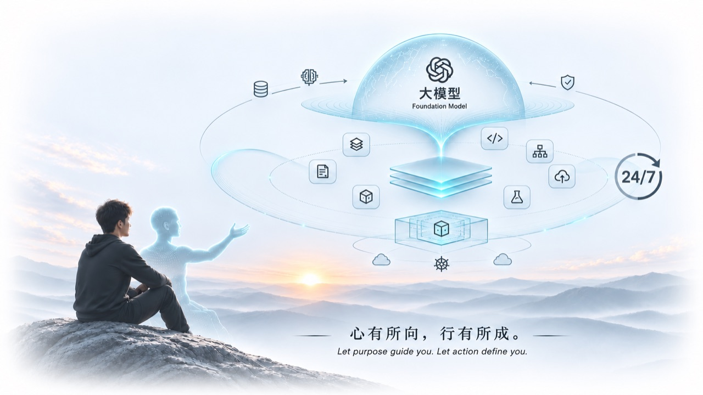

<strong>简体中文</strong> · <a href="README.en.md">English</a>

### 你好，我是长风

常用名**长风**，现居深圳。在 GitHub 记录探索与实践，专注于大模型应用、Agent 工程与 AI 原生基础设施。

我相信，AI 的未来不只是让人更高效地使用工具，而是让人拥有自己的**数字分身**，构建能够自主协作、持续执行的**智能团队**。

我持续探索从 LLM 应用开发、多智能体协作，到数字员工与 Managed Agents 的技术演进。

 

> **人定义方向，数字分身延伸能力，多智能体自主协作，机器持续创造价值。**

### 核心探索方向

- **大模型与智能基础设施** — 大模型应用、上下文工程、长期记忆、模型能力与智能体运行时。
- **多智能体系统** — Agent 编排、任务规划、技能体系、专业 Agent 协作与自主执行。
- **数字分身与数字员工** — 个人知识与经验沉淀、数字分身、智能团队，以及 7×24 小时持续工作的能力。
- **AI 原生研发工程** — Vibe Coding、Spec-Driven Development、Agentic Coding、AI Coding 与 AI Testing。
- **Agent 运行基础设施** — Managed Agents、Agent Harness、Sandbox 隔离、云端执行环境与持久化工作空间。

### 我的技术理念

我希望构建能够理解人的目标、承接人的意图、自主规划任务、协调多个智能体，并持续交付成果的数字化工作体系。

从**一个人使用 AI**，到**一个人拥有自己的数字分身**，再到**一个人指挥一支数字团队**——让人的创造力不再受限于时间，让智能持续延伸人的能力。

### Open Agent Systems

正在建设，探索可组合的 AI 开发工具与基础能力，将上述理念逐步落到工程实践中。

[GitHub 组织](https://github.com/Open-Agent-Systems) · [组织官网](https://open-agent-systems.github.io/zh/)
