  

  <strong>简体中文</strong> · <a href="README.en.md">English</a> &nbsp; / &nbsp;
  <a href="https://github.com/Open-Agent-Systems">Open Agent Systems</a> ·
  <a href="https://open-agent-systems.github.io/zh/">组织官网</a>

## 你好，我是长风

李尚志，深圳，GitHub 上的 **iShangZhi**。一个追逐 AI 前沿、也愿意把想法写成代码的人。

我关注大模型与智能体如何改变软件开发，也在探索从一次模型调用，到能够持续完成工作的智能系统，需要补齐哪些工程能力。学习新技术、动手验证、沉淀工具，是我参与这场变化的方式。

> **心有所向，行有所成。**  
> Let purpose guide you. Let action define you.

## 我的探索坐标 · Focus

| 方向 | 我关注的问题 |
| :--- | :--- |
| **智能体工程** · Agent Engineering | 任务如何编排？多智能体如何协作？上下文、人工介入和异常恢复如何衔接？ |
| **AI 辅助研发** · AI for Development | 编码智能体、技能与工具，怎样真正进入日常研发和交付流程？ |
| **运行基础设施** · Runtime Infrastructure | 从模型接入到沙箱执行，如何让系统可观察、可管理、可持续运行？ |
| **开放协作** · Open Collaboration | 怎样把有效的实践变成独立可用、彼此兼容的开源能力？ |

## 正在建设 · Open Agent Systems

我正在建设 **[Open Agent Systems](https://github.com/Open-Agent-Systems)**，围绕 AI 开发生态的工具与基础能力开展开源探索。

希望让模型、智能体、工具、知识与运行环境形成开放协作的系统。不同项目可以独立解决问题，也能通过清晰的接口组合起来。

组织仍在逐步建设中。官网中的能力体系是长期愿景与探索方向；具体项目以实际公开的仓库和交付内容为准。

**[探索组织 ↗](https://github.com/Open-Agent-Systems)** &nbsp; · &nbsp; **[了解生态愿景 ↗](https://open-agent-systems.github.io/zh/)**

## 探索 → 构建 → 分享

**保持好奇**，理解新模型、新工具和新方法能解决什么问题。  
**动手构建**，在具体场景里检验效果，也认真对待可靠性与使用体验。  
**开放分享**，把有价值的经验沉淀下来，与同行一起完善。

欢迎交流 **Agent 工程、AI 研发工具、云原生运行环境与开源协作**。可以从相关仓库的 Issue 开始，一起讨论具体的问题与想法。
